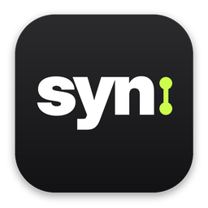
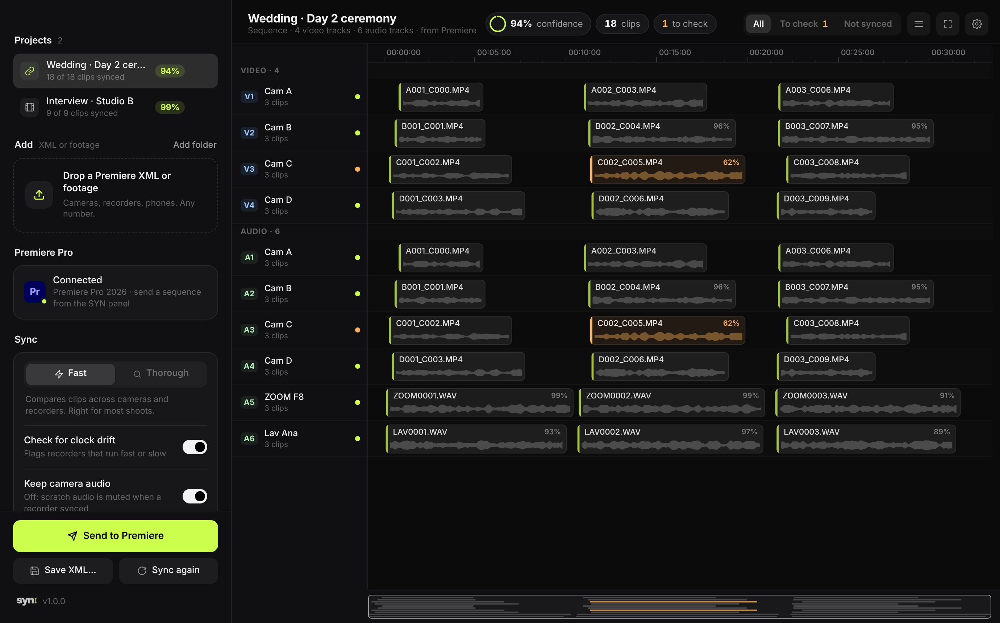

<p align="center">
  
</p>

<h1 align="center">syn</h1>

<p align="center">
  <b>Sync every camera and recorder by sound.</b><br>
  Drop a Premiere XML or the footage itself. Get back a synced sequence, with a confidence score on every clip.<br>
  On your own computer, for macOS and Windows.
</p>

<p align="center">
  <a href="https://github.com/YuvrajxGarg/syn/releases/latest"></a>
  
  <a href="LICENSE"></a>
</p>

<p align="center">
  
</p>

## Download

| Platform | Download | First launch |
|---|---|---|
| **macOS** 11+ · Apple silicon | [**Syn.dmg**](https://github.com/YuvrajxGarg/syn/releases/latest/download/Syn.dmg) | Open it and drag **Syn** to Applications. The app isn't notarized, so the first time: right-click → **Open**. On macOS 15 and later, go to **System Settings → Privacy & Security → Open Anyway** instead. |
| **Windows** 10 / 11 · 64-bit | [**Syn-Setup.exe**](https://github.com/YuvrajxGarg/syn/releases/latest/download/Syn-Setup.exe) | Run the setup. It installs SYN for your account (no admin needed) and, if you leave the box ticked, the SYN panel for Premiere Pro. If SmartScreen appears, click **More info → Run anyway**. |

Or install it from [PXL](https://github.com/YuvrajxGarg/pxl). Website: [syn.pxlvzn.in](https://syn.pxlvzn.in). ffmpeg comes bundled. SYN checks this repository for new releases and updates itself, and updates its Premiere panel with it.

## How it works

1. **Bring in footage.** Either send the open sequence from the **SYN panel in Premiere Pro**, drop a Final Cut Pro 7 XML (*File › Export › Final Cut Pro XML*), or drop the camera and recorder files and folders directly.
2. **Sync.** SYN listens to every clip, finds where each one sits against the others, and slides them into place. *Fast* compares across devices; *Thorough* also compares clips from the same device and accepts weaker matches.
3. **Check what's marked.** Every clip gets a confidence score. Anything under 80% is marked *to check*: the inspector shows what it matched, how much sound they share, the correlation curve, and lets you nudge by frames or drag it. Clips that share no sound with anything are put at the end of the timeline, labelled.
4. **Send it back.** *Send to Premiere* imports the synced sequence straight into the project, or save the XML beside the original. The original sequence is never touched.

Built for big shoots: 20 cameras and 20 recorders is a normal day. The timeline is one canvas, so hundreds of clips on 40+ tracks stay smooth, with a minimap, filters (*To check*, *Not synced*) and keyboard navigation.

## What's in the sync

- **Onset fingerprints.** Each clip's audio is decoded once at 8 kHz (cached), split into 14 log-spaced bands, and turned into a 100 fps onset envelope: when sound *starts*, not how loud it is. Different microphones, levels, EQ and room echo hear the same onsets.
- **FFT cross-correlation** of every pair, normalised by how much the clips overlap, scored against the noise floor of the correlation (a robust z-score) and against the runner-up peak, so repetitive sound doesn't fool it.
- **Sample-accurate refinement** with GCC-PHAT on the raw audio around the best offset.
- **A global solve.** Pairwise matches form a graph; SYN keeps the strongest consistent spanning tree, rejects placements that would overlap clips from the same device, and counts how many other matches agree.
- **Clock drift check.** On long overlaps, the offset is measured at both ends; recorders that run fast or slow are reported in parts per million.

The synced XML keeps your sequence settings, tracks, links and labels, adds tracks only where clips would overlap, and can mute camera scratch audio where a recorder synced.

## Premiere Pro

The SYN panel (Premiere Pro 25.6+, `premiere/`) talks to the app over `127.0.0.1` only. The contract is in [docs/premiere-bridge.md](docs/premiere-bridge.md). The panel pairs once (you click **Allow** in SYN), then *Send to SYN* and *Import synced* are one click each.

## Command line

```
Syn sync <XML or footage…> [-o out.xml] [--mode fast|thorough] [--no-drift] [--mute-camera-audio] [--json]
Syn --install-premiere-plugin | --uninstall-premiere-plugin
```

From source: `pip install -r requirements.txt`, then `python Syn.py` (window) or `python Syn.py sync …`.

## Building

`./build_mac.sh` (macOS) or `build_windows.bat` (Windows). Releases build on GitHub Actions (`.github/workflows/release.yml`) when a `v*` tag is pushed or `VERSION` changes on main: `Syn.dmg`, `Syn-Setup.exe`, and the `Syn-mac.zip` / `Syn-windows.zip` (+ `.sha256`) that installed copies update from. Brand files are in [brand/](brand).

## License

MIT
